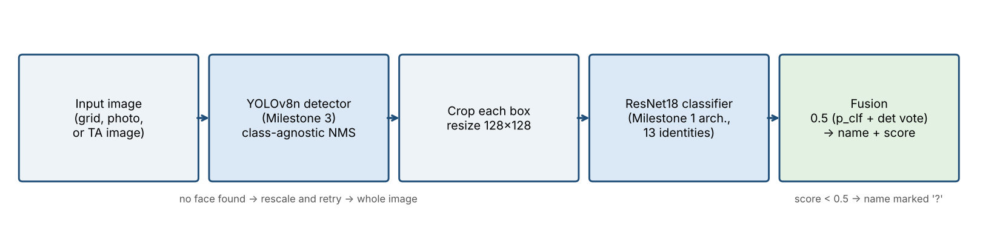
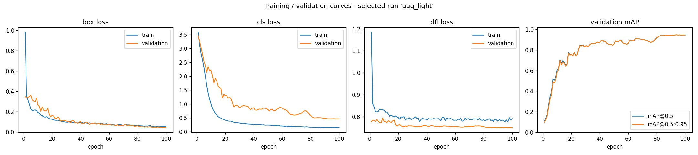
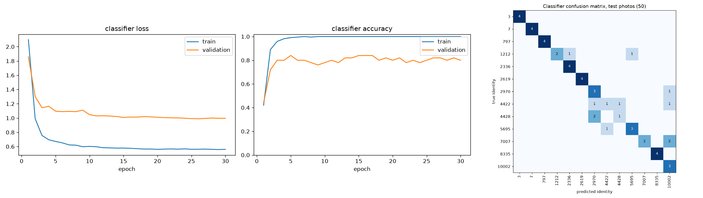
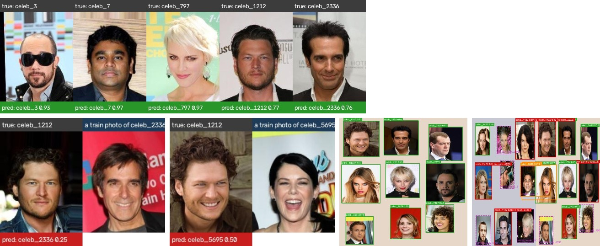
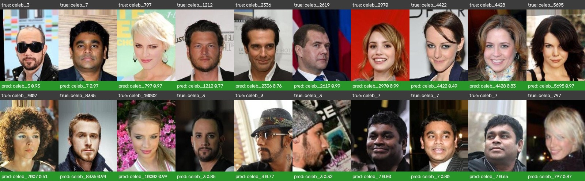

# Celebrity Detection and Identification with YOLOv8 and ResNet18

**IE7615 Deep Learning Architectures — Project 1 Final Report — Group 02** 
Abdellah Faleh, Jin-Woo Hong, Samuel Tong, Tristan Lyons — October 2026 
Repository: https://github.com/AHonGa/ie7615-group-02-project1

## 1. Introduction

The goal of Project 1 is a system that looks at a picture with several faces, finds each face, and
says which celebrity it is. This means two jobs: **finding** each face (drawing a box around it) and
**naming** it (saying who it is). We built the system in four milestones:

- **Milestone 1:** a classifier that names one face.
- **Milestone 2:** our own dataset of pictures with many faces and a box label for each face.
- **Milestone 3:** a YOLOv8 detector that finds the faces and guesses their names.
- **Milestone 4 (this report):** one system that joins the two models. The detector finds the faces
  and the classifier helps to name them.

We work with 13 celebrities from the CelebA dataset, chosen through the class identity pool. Our group
picked four of them (CelebA ids 3, 7, 1212 and 8335), and the other nine come from other groups. Each
person has only 23 to 25 photos. So the main challenge in the whole project was to recognize people
from very few photos.

**Main results.** The detector finds every face in the test pictures, and its boxes are almost
perfect (mean IoU 0.99). The joined system names **89 of 108 test faces correctly (82.4%)**. The
detector alone named 84 (77.8%). The joined system also removes all double boxes. Most of the
remaining mistakes happen between a few people who look alike. This also raises questions about bias,
which we discuss in Section 8.

## 2. Dataset

**Where the photos come from.** All photos come from the CelebA "aligned and cropped" set. Each photo
is 178 × 218 pixels and shows one face. We took all photos of our 13 people: 23 to 25 each, 319 in
total. They are in the folder `extracted_identities/`.

**Splitting the photos.** In Milestone 1 the classifier knew only our 4 people. Now it must know all
13 people. So in Milestone 4 we use the **same photo split as in Milestone 3**
(`detection_dataset_m3/photo_split.csv`). Before we built any picture, we split the photos of each
person into three parts: 70% for training, 15% for validation (checking) and 15% for testing. This
gives 219 training photos, 50 validation photos and 50 test photos (about 17, 4 and 4 per person).
Both models use this same split. This means that **neither model ever sees a test photo during
training**, so the test is fair. Both models also use the same number for each person.

**Pictures with many faces.** Each detection picture is 640 × 640 pixels and holds a 3 × 3 grid of 9
different celebrities. Each face is made a little smaller, so it fills 65% to 92% of its grid cell,
and it is placed at a random spot on a plain background. At the same moment, we write its YOLO label
(the person and the box). So every box is exactly right.

**Why we rebuilt the Milestone 2 data.** The Milestone 2 dataset had only 30 pictures. In Milestone 3
we found that it used only about 4 of the ~25 photos of each person, and that 4 people were missing
from its test part. Because of this, the detector could not learn who is who (test mAP@0.5 = 0.23).
With the TA's approval, we rebuilt the dataset with the same method, but with the photo split above
and more pictures: **120 training, 12 validation and 12 test pictures** (108 test faces). Every
person appears in every part. All dataset scripts are in `src/`, and they always give the same result
(random seed 42).

## 3. Models and training

We **fine-tuned** both models. This means we started from models that had already learned from
millions of images, and then we trained them on our task. We did not train any model from scratch,
because we have too few photos for that.

**The classifier (ResNet18, from Milestone 1).** In Milestone 1 we compared two models on our 4
people: a small CNN that we trained from scratch, and a ResNet18 that was already trained on
ImageNet. The ResNet18 got 87.5% right on the test photos, and the small CNN only 50%. With only ~17
photos per person, a model that starts from nothing cannot learn good face features, but a pretrained
model can reuse what it already knows. So we kept the ResNet18 (`src/models.py`) and trained it again
for all 13 people. We kept the model from the best epoch on validation
(`models/celeba_resnet18_13id.pt`). Training takes about 10 minutes on a normal laptop.

**The detector (YOLOv8, from Milestone 3).** We used YOLOv8n, which was already trained on the COCO
dataset, and fine-tuned it with one class for each person. We tried six settings: a lower and a higher
learning rate, a smaller image size, lighter image changes, and a larger model (YOLOv8s). We picked
the best one using only the validation pictures. The winner was **`aug_light`**: YOLOv8n with lighter
image changes (`models/celeba_yolov8_best.pt`). Table 1 shows the training settings of both models.

| Setting | ResNet18 classifier | YOLOv8n detector |
|---|---|---|
| Already trained on | ImageNet | COCO |
| Input | 128 × 128 face crop | 640 × 640 grid picture |
| Optimizer, learning rate | AdamW, 0.0003, cosine schedule | AdamW, 0.001 |
| Batch size, epochs | 32, 30 (best epoch 5) | 16, up to 100 (stops early after 30 without progress) |
| Loss | Cross-entropy, label smoothing 0.1 | YOLOv8 loss (box + class + DFL) |
| Image changes (augmentation) | Flip, small shift and zoom, small rotation, colour changes | No mosaic, small scale and shift, light colour changes |
| Training data | 219 face photos | 120 pictures (1,080 faces) |
| Training time | ~10 min on a laptop CPU | ~30–45 min for all six runs on a Colab T4 GPU |

*Table 1. Training settings of the two fine-tuned models.*

**The joined system (Milestone 4).** Figure 1 shows how the system works (`src/m4_pipeline.py`):

1. **Find the faces.** YOLOv8 finds the faces and draws **one box per face**. In Milestone 3 the
   detector sometimes drew two boxes with two different names on the same face. Now we use
   "class-agnostic" suppression: when two boxes cover the same face, only the stronger one is kept.
2. **Cut out and name.** We cut out each face, resize it to 128 × 128, and the ResNet18 gives a score
   for each of the 13 people.
3. **Vote.** Both models vote. The final score of each person is the average of the classifier's
   score and the detector's vote: `score = 0.5 × (classifier score + detector vote)`. The detector
   votes only for the name it picked, with its confidence. The name with the highest score wins. When
   the two models agree, the score is high. When they disagree, the more confident one usually wins.
4. **Backup plan for new pictures.** The detector learned faces that fill one grid cell. So it may
   find nothing in a single close-up portrait. In that case, we make the picture smaller, put it on a
   blank canvas and search again. If it still finds nothing, the whole picture is named as one face.
   If the final score is below 0.5, the name is shown with a "?".

The whole system runs with one command: `python src/identify.py --source <image or folder>`. For the
live demo there is a web page: `python src/identify.py --app`. We chose how to name the faces
(detector only, classifier only, or both voting) using the validation pictures.

## 4. How we tested

All results below are on photos that the models never saw during training. We made every choice
(best epoch, detector setting, naming method) **using only the validation part**. We used the test
part only once, at the end, to report the results.

- **Classifier:** how many of the 50 validation photos and 50 test photos it names correctly, per
  person, and a confusion matrix (a chart that shows which people get mixed up).
- **Detector:** the usual detection scores (mAP@0.5, mAP@0.5:0.95, precision and recall), and the
  mean IoU, which measures how well our boxes overlap the true boxes (1.0 = perfect).
- **Joined system:** we match each predicted box to the true face it overlaps most (IoU at least
  0.5). A face counts as **correct** only if it is found **and** gets the right name. We also count
  wrong names, missed faces and extra boxes. "Faces correctly named" is our main score, because it is
  what a user of the system sees.
- **Hard pictures:** harder copies of the test pictures (smaller faces, darker, blurred, and two grids
  squeezed into one picture), plus one new test picture from the TA.

## 5. Results

**Detector (Milestone 3, test pictures).** mAP@0.5 = 0.879, mAP@0.5:0.95 = 0.876, precision 0.849,
recall 0.759, mean IoU 0.993. The detector found all 108 test faces and named 84 of them correctly.
The learning rate mattered most: a 5 times higher learning rate dropped the validation mAP@0.5 from
0.90 to 0.74. Lighter image changes worked best (validation mAP@0.5:0.95 of 0.947, against 0.896 for
the baseline). On the original 30-picture dataset, the same setting reached only 0.232. Table 2 shows
all six runs.

| Run | Model | Learning rate | Image size | Val mAP@0.5 | Val mAP@0.5:0.95 | Test mAP@0.5 |
|---|---|---|---|---|---|---|
| baseline | YOLOv8n | 0.001 | 640 | 0.897 | 0.896 | 0.799 |
| lr_low | YOLOv8n | 0.0002 | 640 | 0.864 | 0.863 | 0.861 |
| lr_high | YOLOv8n | 0.005 | 640 | 0.737 | 0.737 | 0.687 |
| imgsz_416 | YOLOv8n | 0.001 | 416 | 0.835 | 0.835 | 0.847 |
| **aug_light (chosen)** | YOLOv8n | 0.001 | 640 | **0.947** | **0.947** | **0.879** |
| yolov8s_aug_light | YOLOv8s | 0.001 | 640 | 0.933 | 0.933 | 0.936 |

*Table 2. The six detector runs from Milestone 3. We chose the run with the best validation score.*

Figure 2 shows how the detector learned. The box loss goes down for both training and validation, so
the detector learns well **where** the faces are. But the validation class loss stays much higher than
the training class loss. This was the first sign that the hard part is **who**, not where.

**Classifier (single face photos).** The 13-person ResNet18 got **84% right on validation (42 of 50)**
and **78% right on test (39 of 50)**. By epoch 7 it got 100% of the training photos right, but on
validation it stayed around 80% (Figure 3, left). This means the model memorizes its ~17 photos per
person (overfitting). So we use the model from epoch 5, the best epoch on validation. Seven of the 13
people got every test photo right, including three of our four (celeb_3, celeb_7, celeb_8335). The
weakest were celeb_4422 (1 of 4), celeb_4428 (1 of 3), and celeb_1212 and celeb_7007 (2 of 4 each).
Table 3 shows every person.

| Person | Test photos | Correct | Accuracy | | Person | Test photos | Correct | Accuracy |
|---|---|---|---|---|---|---|---|---|
| celeb_3 (ours) | 4 | 4 | 100% | | celeb_4422 | 4 | 1 | 25% |
| celeb_7 (ours) | 4 | 4 | 100% | | celeb_4428 | 3 | 1 | 33% |
| celeb_797 | 4 | 4 | 100% | | celeb_5695 | 4 | 3 | 75% |
| celeb_1212 (ours) | 4 | 2 | 50% | | celeb_7007 | 4 | 2 | 50% |
| celeb_2336 | 4 | 4 | 100% | | celeb_8335 (ours) | 4 | 4 | 100% |
| celeb_2619 | 4 | 4 | 100% | | celeb_10002 | 3 | 3 | 100% |
| celeb_2970 | 4 | 3 | 75% | | **All 13** | **50** | **39** | **78%** |

*Table 3. Classifier test accuracy for each person (single face photos).*

**Joined system (pictures with many faces).** Table 4 compares the four ways of naming the faces.
Voting is the best on both validation and test:

| Way of naming | Val correct (of 108) | Test correct (of 108) | Test wrong name | Test extra boxes | Test mean IoU |
|---|---|---|---|---|---|
| Milestone 3 detector alone | 95 (88.0%) | 84 (77.8%) | 24 | 8 | 0.993 |
| Detector alone, one box per face | 95 (88.0%) | 84 (77.8%) | 24 | 0 | 0.993 |
| Detector boxes + classifier names | 89 (82.4%) | 80 (74.1%) | 28 | 0 | 0.991 |
| **Both models vote (chosen)** | **98 (90.7%)** | **89 (82.4%)** | **19** | **0** | **0.991** |

*Table 4. The four ways of naming faces, on validation and test. We chose the way using validation.*

Voting names 5 more test faces correctly than the detector alone, and it removes all 8 double boxes.
No face was missed. In the gallery, 2 of the 12 test pictures are fully correct, and every picture
has at least 6 of 9 faces right.

**Hard pictures.** Table 5 shows the results on the harder copies. Voting helps most where the
detector is weakest (crowded and small faces). But all four hard cases are still much worse than the
normal test pictures.

| Hard test (18 faces each) | What we changed | Milestone 3 detector | Joined system (vote) |
|---|---|---|---|
| Crowded | Two grids squeezed into one picture | 3 of 18 | **6 of 18** |
| Dark | Brightness cut to 30% | 10 of 18 | 10 of 18 |
| Blurred | Strong blur | 10 of 18 | 10 of 18 |
| Small faces | Faces shrunk to 45% | 1 of 18 | **2 of 18** |
| *Normal test pictures (for comparison)* | — | *84 of 108 (78%)* | *89 of 108 (82%)* |

*Table 5. Faces correctly named on the harder copies of the test pictures.*

The TA also gave us a new picture: a 3 × 3 grid on a green background, a colour we never used in
training. The detector found all 9 faces and named all 9 correctly, with confidence 0.98 to 1.00.

**Final gallery** (`results/milestone4/gallery/README.md`, examples in Figures 4 and 5): 20 single
faces named correctly (at least one for each person), 11 single faces named wrongly (each with a short
explanation and a training photo of the person it was mixed up with), and 19 pictures with many faces
(12 test pictures and 7 hard pictures), with coloured boxes and captions.

## 6. Live demonstration

In the final evaluation, the TA tests two things on pictures we have never seen: **naming a single
face** and **finding and naming many faces** (with boxes). Both use the same command,
`python src/identify.py`, so nothing changes between the two cases.

**One face.** A close-up portrait is the hardest input for our detector, because it learned faces
that fill one cell of a 640-pixel grid. The backup plan from Section 3 handles this: if no face is
found, the picture is made smaller and searched again, and if that also fails, the whole picture is
named as one face. In every case the classifier still names the face, so a single portrait always
gets exactly one name and score.

**Many faces.** In a group picture, the detector draws one box per face. Each box is cut out and named,
and the final name is written on the box. Sure names get a green box. A name with a score below 0.5
gets an orange box and a "?", so everyone can see when the system is unsure.

**What the demo shows.** The web page (`python src/identify.py --app`, or `--share` to get a public
link for the Zoom session) takes an uploaded picture. It shows the picture with boxes and names, and a
table with one row per face: the final name and score, the detector's vote, the classifier's vote, how
the face was found (by the detector, after making the picture smaller, or as the whole picture), and
the box position. Because both votes are shown, the audience can see when the two models agree and
when one model corrects the other. On the page we can also switch the naming method (detector,
classifier or vote) and change the detector's confidence level. This lets us show the comparison of
Table 4 live.

**Practice.** Before the session, we ran the demo on the test pictures and shared the public link with
the team, so the presenter does not need the code on their computer. In Milestone 3, the detector
alone named all 9 faces in the TA's new test picture correctly. The demo runs on a normal laptop; no GPU
is needed.

## 7. Analysis and limitations

**Finding faces is solved; naming them is the hard part.** In every test, the detector finds almost
every face with almost perfect boxes (IoU about 0.99). This is why mAP@0.5 and mAP@0.5:0.95 are almost
the same. All remaining mistakes are about **who**, not **where**.

**Why voting helps.** The two models make different mistakes. The detector sees each face as part of
the whole 640-pixel picture. The classifier sees only a small 128-pixel crop, and it was trained on
normal photos. Alone, the classifier is a little weaker on grid pictures (80 against 84 correct). But
when the two scores are averaged, a sure and correct vote from one model can beat an unsure and wrong
vote from the other. This fixed 5 test faces. Keeping one box per face is a separate, free
improvement: it removes double boxes without changing any correct answer.

**What the classifier gets wrong.** It made 11 mistakes on the test photos. In 8 of them, its top
score was below 0.5, and in 6 of them, the right person was its second guess. So most mistakes are
unsure, not confident. Nine of the 11 mistakes involve the same five people (celeb_2970, 4422, 4428,
7007 and 10002). They are all women with long hair; for example, celeb_4428 was twice named as
celeb_2970. The other two mistakes are our own celeb_1212. Once he was named as another man with dark
hair (celeb_2336), and once as celeb_5695. Both times the right name was the second guess. With only
about 17 training photos per person, the model looks at hair, pose and light as much as at the face
itself.

**Limitations.**
(1) *Few photos:* only 17 training photos per person. The validation and test parts have only 50
photos and 12 pictures, so a difference of a few faces between two methods may be just chance.
(2) *Made-up pictures:* our faces are clean crops on plain backgrounds, all at similar sizes. Very
small faces (2 of 18 correct) and real group photos, with overlapping faces, different light and
covered faces, would be much harder.
(3) *Closed set:* the system always picks one of the 13 people. A stranger will get a celebrity's
name. The "?" for low scores helps only a little, and we did not test an "unknown person" option.
(4) *One split:* all results come from one data split. Repeating with other splits would show how much
the results can change.
(5) The larger YOLOv8s scored higher on test (mAP@0.5 0.936) but lower on validation, so we did not
choose it. It is the first thing to try next, together with training on smaller and overlapping faces
and adding an "unknown" class.

## 8. Ethical considerations

Face recognition is one of the most sensitive uses of computer vision. Even our small class project
shows the main risks clearly.

**Bias and unequal accuracy.** Our system works much better for some people than for others. On the
test photos, accuracy goes from 100% for seven people down to 25% for one person. The mistakes are not
random: 9 of the 11 classifier mistakes involve the same five women with similar hair. In our small
set, the reason is that these people look alike and have too few photos. We did not measure a
demographic effect. But this is exactly how bias starts in real systems. When some groups have fewer
photos, or less varied photos, the model learns weaker features for them and fails more often for them.
Large independent studies found the same pattern in commercial systems. NIST's study of face
recognition found that error rates differ a lot by sex, age and race. The Gender Shades study found
that commercial face-analysis systems made many more mistakes for darker-skinned women than for
lighter-skinned men. CelebA itself is not balanced. It contains celebrities photographed at public
events, with more people of some ages, ethnicities and styles than others. So a model trained on it
should not be expected to work equally well for everyone. A responsible system would report accuracy
for each group of people, use more balanced data, and refuse to give a name when it is unsure, instead
of reporting one average score. Our tables for each person are a small step in that direction.

**Privacy and consent.** The people in CelebA never agreed to have their faces used to train face
recognition models. The photos were collected from the internet. The dataset is allowed for
non-commercial research, but being famous does not mean someone agrees to be identified automatically.
A face is a permanent personal identifier: unlike a password, you cannot change it if it leaks. Many
places now treat face data as sensitive data with strict rules, for example the GDPR in the EU and the BIPA law in Illinois. Depending on the place and the use, these rules can require consent or another legal basis. A real system would need consent where it applies, a clear purpose, limits on how long
images and face data are kept, and a way for people to opt out. In this project we used the data only
for coursework, we did not collect any new photos of people, and we did not build a database of faces.

**Misuse.** The same system that names celebrities in a grid could, with other photos, identify private
people in street, protest or classroom photos. It could be used to track people, stalk them, or target
activists. Even with good intentions, a wrong match can hurt someone. There are real cases of people
arrested by mistake because of a wrong face match. Our system shows why this happens: it always gives
**someone's** name, often with high confidence, even for a person it has never seen. Ways to reduce
the risk include: using the system only for people who agreed and signed up; showing when the system
is unsure (our "?"); keeping a human in charge of any decision about a person; recording and checking
how the system is used; and not sharing models that recognize specific people. We share only code and
models for 13 public figures from a research dataset. The system is not meant for, and does not work
for, identifying anyone else.

**What we learned.** Accuracy alone is not the right way to judge a face recognition system. Who it
fails for, whether people agreed to be in it, and what happens when it is wrong matter as much as the
average score. Having so few photos made this real for us: with 17 photos per person, our model was
much better for some people than for others.

## 9. Conclusion

We built a complete system that finds and names 13 celebrities in pictures with many faces. Our grid
dataset, with a strict photo split, made the test fair. A fine-tuned YOLOv8n solved the finding part
(IoU 0.99). Joining it with a fine-tuned ResNet18 classifier raised the share of correctly named test
faces from 77.8% to 82.4%, and removed all double boxes. The remaining mistakes happen between people
who look alike, mainly because we have only about 17 photos per person. They remind us that a face
recognition system must be judged by who it fails for, not only by how often it fails.

**How to repeat our results.** Run `pip install -r requirements.txt`, then
`python src/run_milestone3.py` (detector; a GPU is recommended) and `python src/run_milestone4.py`
(classifier, joined system and gallery; works on a normal laptop). All splits always come out the
same (seed 42), and the trained models are saved in `models/`.

**Team contributions.** *Abdellah Faleh:* Milestone 1 data pipeline and models; Milestone 2 dataset
pipeline; Milestone 3 larger dataset, training runs, evaluation and report; Milestone 4 joined system,
classifier retraining, gallery and final report. *Jin-Woo Hong:* repository setup and maintenance;
Milestone 2 face-grid pipeline; Milestone 3 baseline on the original dataset, evaluation scripts and
live-demo notebook. *Samuel Tong:* evaluation and review in every milestone, Milestone 3 evaluation
review, checking that the rubric is complete. *Tristan Lyons:* planning, code and results review,
submission checklist, Canvas submissions and contact with the TA. All members take part in the final
presentation.

**References.**

- Z. Liu, P. Luo, X. Wang, X. Tang. *Deep Learning Face Attributes in the Wild* (CelebA). ICCV 2015.
- K. He, X. Zhang, S. Ren, J. Sun. *Deep Residual Learning for Image Recognition.* CVPR 2016.
- G. Jocher, A. Chaurasia, J. Qiu. *Ultralytics YOLOv8*, 2023. https://github.com/ultralytics/ultralytics
- P. Grother, M. Ngan, K. Hanaoka. *Face Recognition Vendor Test Part 3: Demographic Effects.* NIST IR 8280, 2019.
- J. Buolamwini, T. Gebru. *Gender Shades: Intersectional Accuracy Disparities in Commercial Gender Classification.* FAT* 2018.
