# Milestone 4 final results gallery

Generated by `src/run_milestone4.py` from held-out photos and grids (never used for training).

## 1. Correctly classified single faces

20 test photos named correctly by the 13-identity ResNet18 classifier (test accuracy 39/50). At least one per identity.

| # | image | true identity | predicted | confidence |
|---|---|---|---|---|
| 1 | 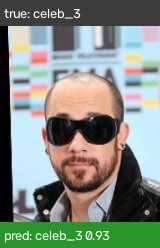 | celeb_3 | celeb_3 | 0.93 |
| 2 |  | celeb_7 | celeb_7 | 0.97 |
| 3 |  | celeb_797 | celeb_797 | 0.97 |
| 4 | 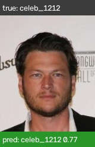 | celeb_1212 | celeb_1212 | 0.77 |
| 5 | 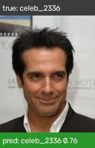 | celeb_2336 | celeb_2336 | 0.76 |
| 6 |  | celeb_2619 | celeb_2619 | 0.99 |
| 7 | 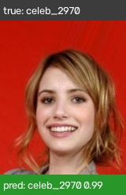 | celeb_2970 | celeb_2970 | 0.99 |
| 8 | 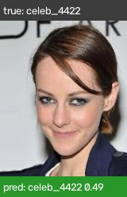 | celeb_4422 | celeb_4422 | 0.49 |
| 9 |  | celeb_4428 | celeb_4428 | 0.83 |
| 10 | 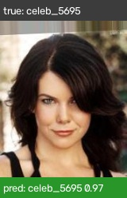 | celeb_5695 | celeb_5695 | 0.97 |
| 11 | 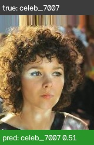 | celeb_7007 | celeb_7007 | 0.51 |
| 12 |  | celeb_8335 | celeb_8335 | 0.94 |
| 13 | 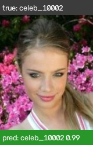 | celeb_10002 | celeb_10002 | 0.99 |
| 14 | 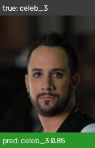 | celeb_3 | celeb_3 | 0.85 |
| 15 | 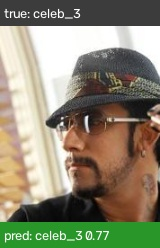 | celeb_3 | celeb_3 | 0.77 |
| 16 | 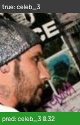 | celeb_3 | celeb_3 | 0.32 |
| 17 |  | celeb_7 | celeb_7 | 0.80 |
| 18 | 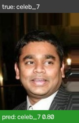 | celeb_7 | celeb_7 | 0.80 |
| 19 |  | celeb_7 | celeb_7 | 0.65 |
| 20 |  | celeb_797 | celeb_797 | 0.87 |

## 2. Misclassified single faces

Each card shows the photo, the wrong prediction, and a training photo of the predicted identity.

### 1. celeb_1212 predicted as celeb_2336 (test photo)

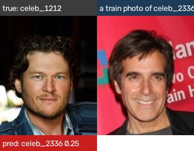

**celeb_1212** predicted as **celeb_2336**. Unsure mistake: top score only 0.25; the true identity was the second guess. Compare with the training photo of celeb_2336 on the right: similar pose, hair or lighting is the usual cause with ~17 training photos per identity.

### 2. celeb_1212 predicted as celeb_5695 (test photo)

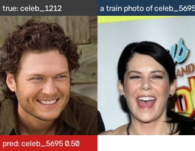

**celeb_1212** predicted as **celeb_5695**. Unsure mistake: top score only 0.50; the true identity was the second guess. Compare with the training photo of celeb_5695 on the right: similar pose, hair or lighting is the usual cause with ~17 training photos per identity.

### 3. celeb_2970 predicted as celeb_10002 (test photo)

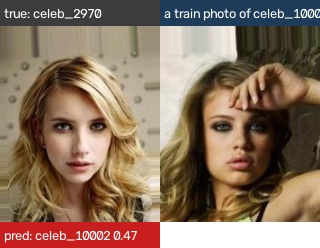

**celeb_2970** predicted as **celeb_10002**. Unsure mistake: top score only 0.47, true identity scored 0.19. Compare with the training photo of celeb_10002 on the right: similar pose, hair or lighting is the usual cause with ~17 training photos per identity.

### 4. celeb_4422 predicted as celeb_10002 (test photo)

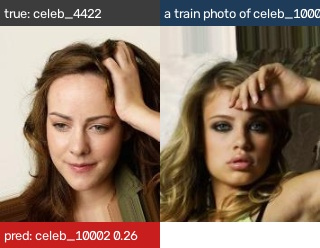

**celeb_4422** predicted as **celeb_10002**. Unsure mistake: top score only 0.26, true identity scored 0.13. Compare with the training photo of celeb_10002 on the right: similar pose, hair or lighting is the usual cause with ~17 training photos per identity.

### 5. celeb_4422 predicted as celeb_2970 (test photo)

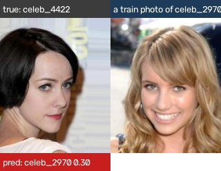

**celeb_4422** predicted as **celeb_2970**. Unsure mistake: top score only 0.30; the true identity was the second guess. Compare with the training photo of celeb_2970 on the right: similar pose, hair or lighting is the usual cause with ~17 training photos per identity.

### 6. celeb_4422 predicted as celeb_4428 (test photo)

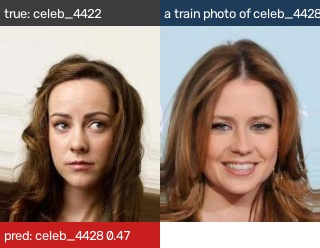

**celeb_4422** predicted as **celeb_4428**. Unsure mistake: top score only 0.47, true identity scored 0.01. Compare with the training photo of celeb_4428 on the right: similar pose, hair or lighting is the usual cause with ~17 training photos per identity.

### 7. celeb_4428 predicted as celeb_2970 (test photo)

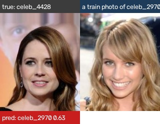

**celeb_4428** predicted as **celeb_2970**. Confident mistake (0.63); the true identity scored only 0.03. Compare with the training photo of celeb_2970 on the right: similar pose, hair or lighting is the usual cause with ~17 training photos per identity.

### 8. celeb_4428 predicted as celeb_2970 (test photo)

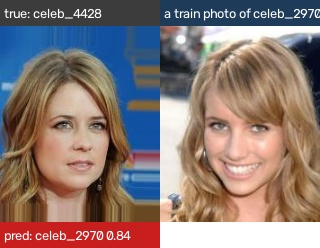

**celeb_4428** predicted as **celeb_2970**. Confident mistake (0.84); the true identity scored only 0.03. Compare with the training photo of celeb_2970 on the right: similar pose, hair or lighting is the usual cause with ~17 training photos per identity.

### 9. celeb_5695 predicted as celeb_4422 (test photo)

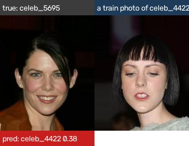

**celeb_5695** predicted as **celeb_4422**. Unsure mistake: top score only 0.38; the true identity was the second guess. Compare with the training photo of celeb_4422 on the right: similar pose, hair or lighting is the usual cause with ~17 training photos per identity.

### 10. celeb_7007 predicted as celeb_10002 (test photo)

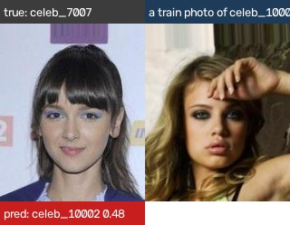

**celeb_7007** predicted as **celeb_10002**. Unsure mistake: top score only 0.48; the true identity was the second guess. Compare with the training photo of celeb_10002 on the right: similar pose, hair or lighting is the usual cause with ~17 training photos per identity.

### 11. celeb_7007 predicted as celeb_10002 (test photo)

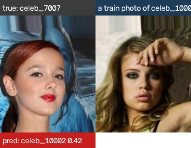

**celeb_7007** predicted as **celeb_10002**. Unsure mistake: top score only 0.42; the true identity was the second guess. Compare with the training photo of celeb_10002 on the right: similar pose, hair or lighting is the usual cause with ~17 training photos per identity.

## 3. Multi-face detection and identification

Integrated pipeline (`fusion` mode). Green = correct identity, red = wrong identity (true identity in brackets), orange = extra box, dashed magenta = missed face.

### 01_test_0001.jpg

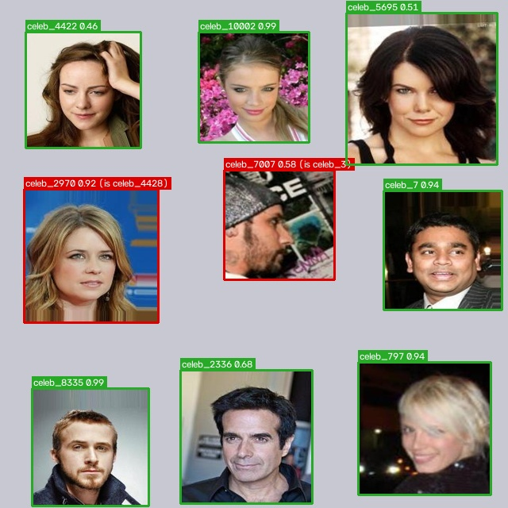

**Partial.** Test grid: 7/9 faces detected with the correct identity; confidence 0.46-0.99; identity confusion: celeb_4428 predicted as celeb_2970; celeb_3 predicted as celeb_7007.

### 02_test_0002.jpg

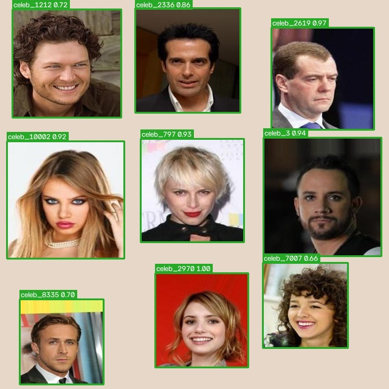

**Success.** Test grid: 9/9 faces detected with the correct identity; confidence 0.66-1.00.

### 03_test_0003.jpg

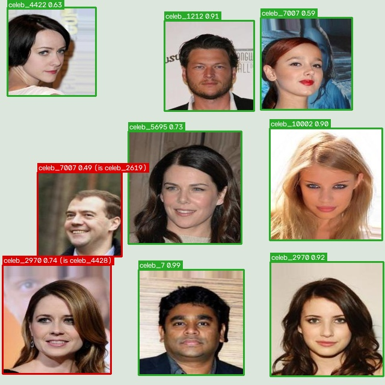

**Partial.** Test grid: 7/9 faces detected with the correct identity; confidence 0.59-0.99; identity confusion: celeb_2619 predicted as celeb_7007; celeb_4428 predicted as celeb_2970.

### 04_test_0004.jpg

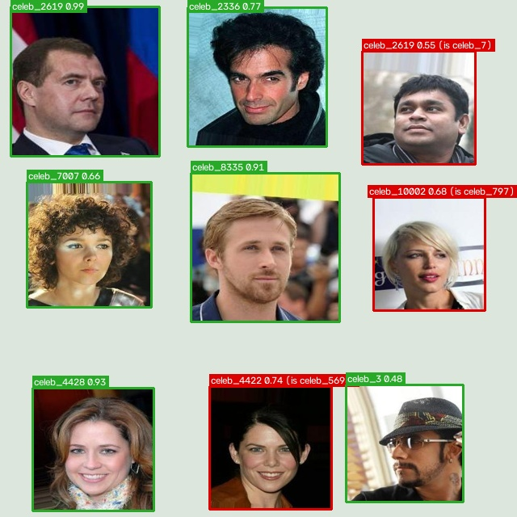

**Partial.** Test grid: 6/9 faces detected with the correct identity; confidence 0.48-0.99; identity confusion: celeb_797 predicted as celeb_10002; celeb_5695 predicted as celeb_4422; celeb_7 predicted as celeb_2619.

### 05_test_0005.jpg

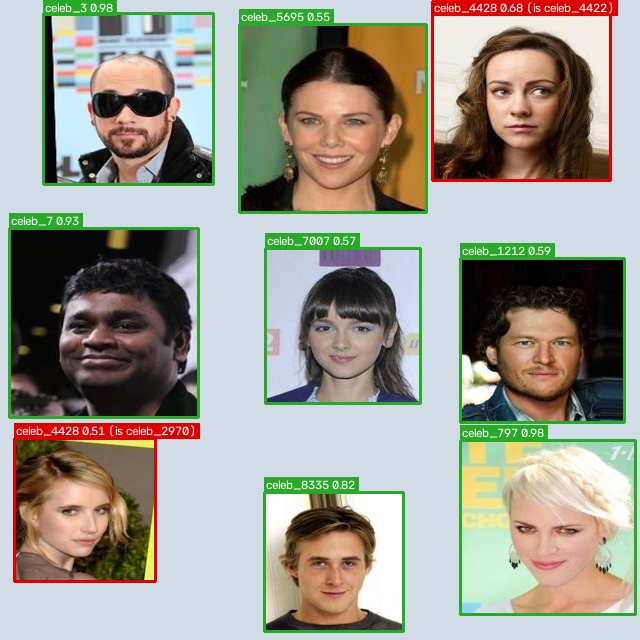

**Partial.** Test grid: 7/9 faces detected with the correct identity; confidence 0.55-0.98; identity confusion: celeb_2970 predicted as celeb_4428; celeb_4422 predicted as celeb_4428.

### 06_test_0006.jpg

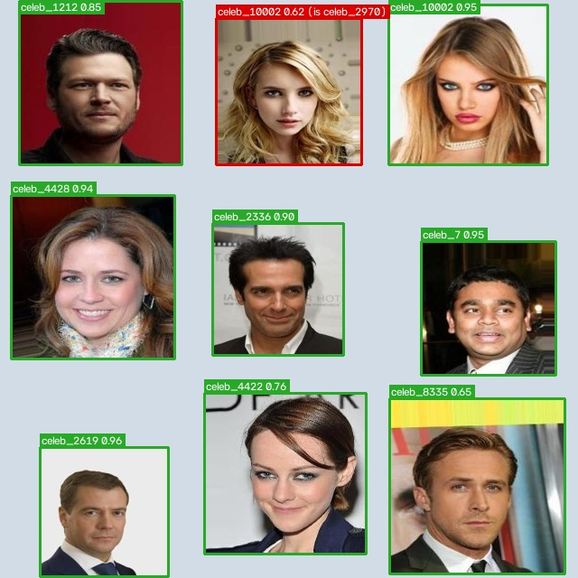

**Success.** Test grid: 8/9 faces detected with the correct identity; confidence 0.65-0.96; identity confusion: celeb_2970 predicted as celeb_10002.

### 07_test_0007.jpg

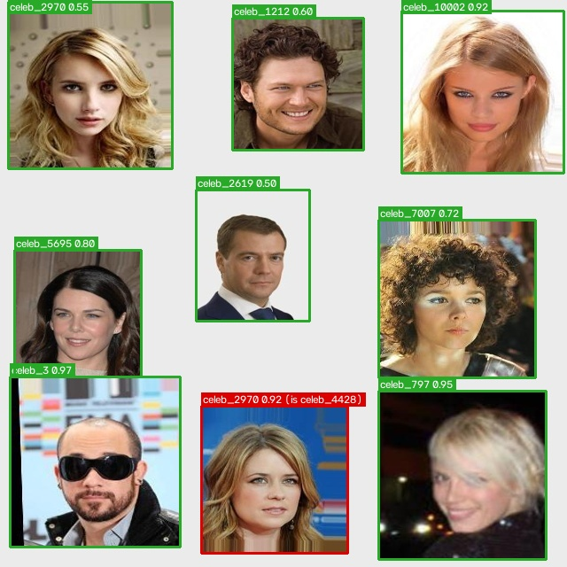

**Success.** Test grid: 8/9 faces detected with the correct identity; confidence 0.50-0.97; identity confusion: celeb_4428 predicted as celeb_2970.

### 08_test_0008.jpg

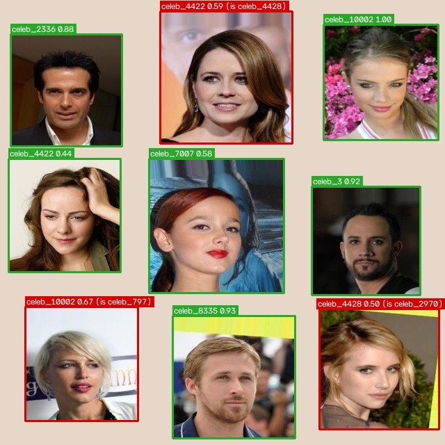

**Partial.** Test grid: 6/9 faces detected with the correct identity; confidence 0.44-1.00; identity confusion: celeb_797 predicted as celeb_10002; celeb_2970 predicted as celeb_4428; celeb_4428 predicted as celeb_4422.

### 09_test_0009.jpg

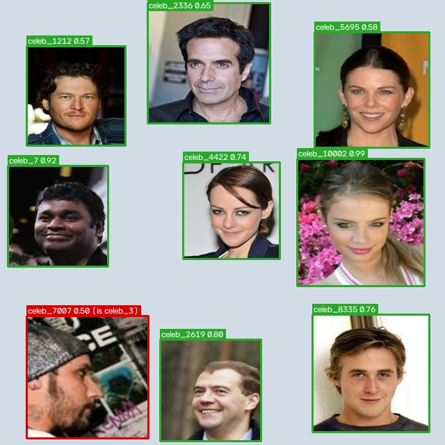

**Success.** Test grid: 8/9 faces detected with the correct identity; confidence 0.57-0.99; identity confusion: celeb_3 predicted as celeb_7007.

### 10_test_0010.jpg

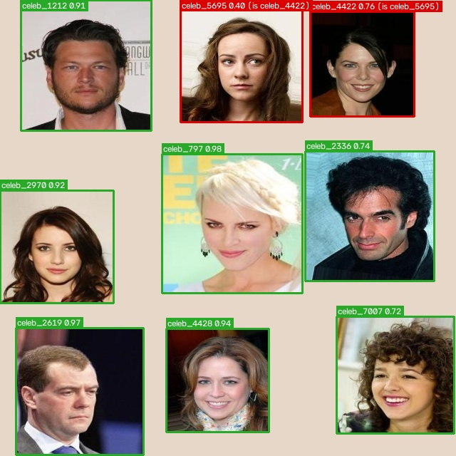

**Partial.** Test grid: 7/9 faces detected with the correct identity; confidence 0.72-0.98; identity confusion: celeb_5695 predicted as celeb_4422; celeb_4422 predicted as celeb_5695.

### 11_test_0011.jpg

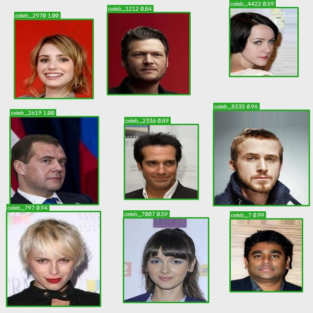

**Success.** Test grid: 9/9 faces detected with the correct identity; confidence 0.59-1.00.

### 12_test_0012.jpg

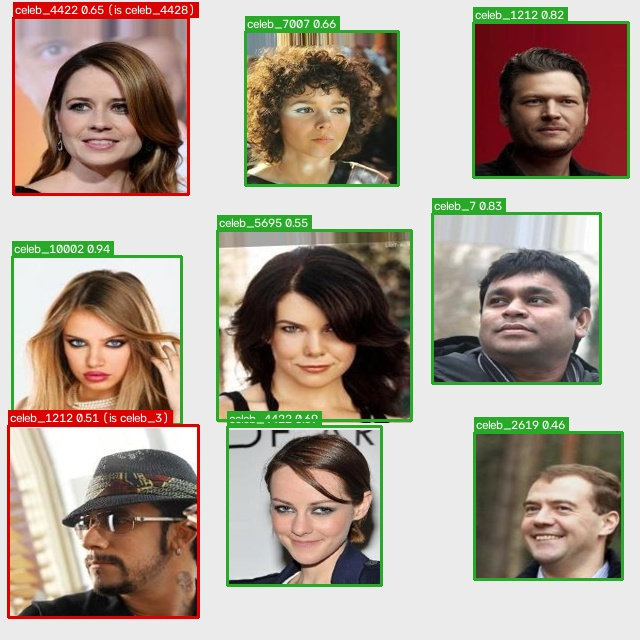

**Partial.** Test grid: 7/9 faces detected with the correct identity; confidence 0.46-0.94; identity confusion: celeb_3 predicted as celeb_1212; celeb_4428 predicted as celeb_4422.

### 13_crowded_two_frames.jpg

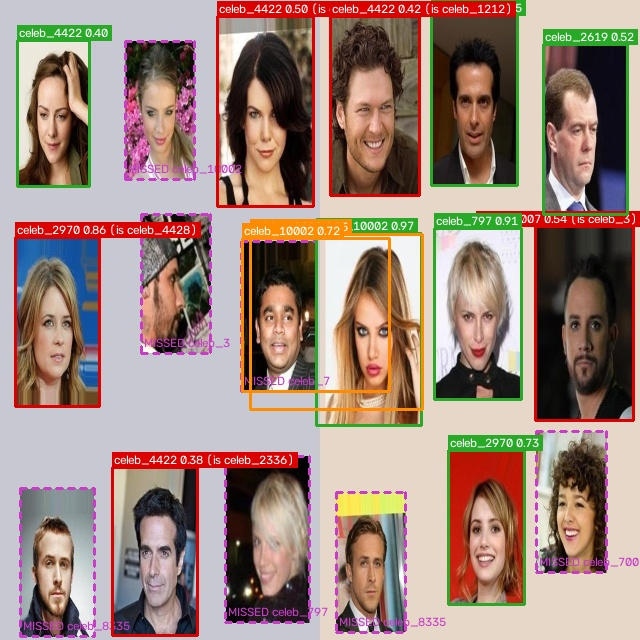

**Failure.** Stress test (from Milestone 3): 6/18 faces detected with the correct identity; confidence 0.40-0.97; missed celeb_10002, celeb_797, celeb_3, celeb_8335, celeb_7, celeb_7007, celeb_8335; identity confusion: celeb_3 predicted as celeb_7007; celeb_5695 predicted as celeb_4422; celeb_1212 predicted as celeb_4422; celeb_4428 predicted as celeb_2970; celeb_2336 predicted as celeb_4422; 2 extra box(es) on background or duplicate faces.

### 14_test_0001_blur.jpg

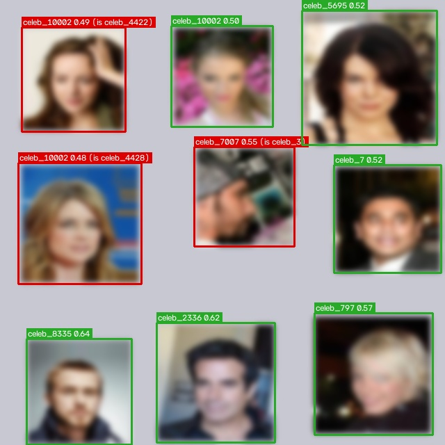

**Partial.** Stress test (from Milestone 3): 6/9 faces detected with the correct identity; confidence 0.50-0.64; identity confusion: celeb_3 predicted as celeb_7007; celeb_4422 predicted as celeb_10002; celeb_4428 predicted as celeb_10002.

### 15_test_0001_dark.jpg

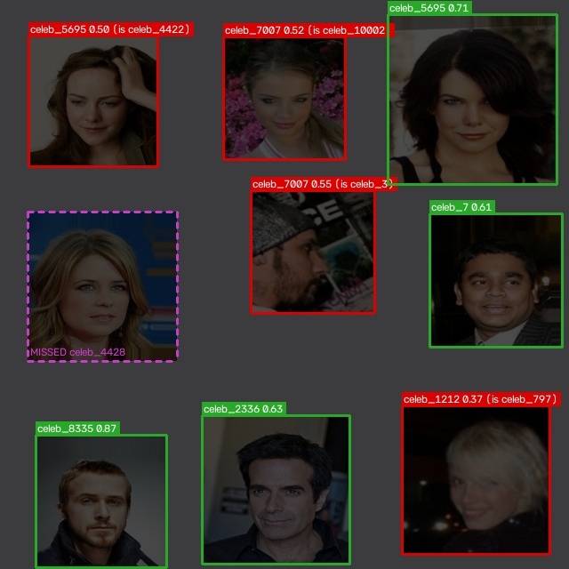

**Failure.** Stress test (from Milestone 3): 4/9 faces detected with the correct identity; confidence 0.61-0.87; missed celeb_4428; identity confusion: celeb_3 predicted as celeb_7007; celeb_10002 predicted as celeb_7007; celeb_4422 predicted as celeb_5695; celeb_797 predicted as celeb_1212.

### 16_test_0001_small.jpg

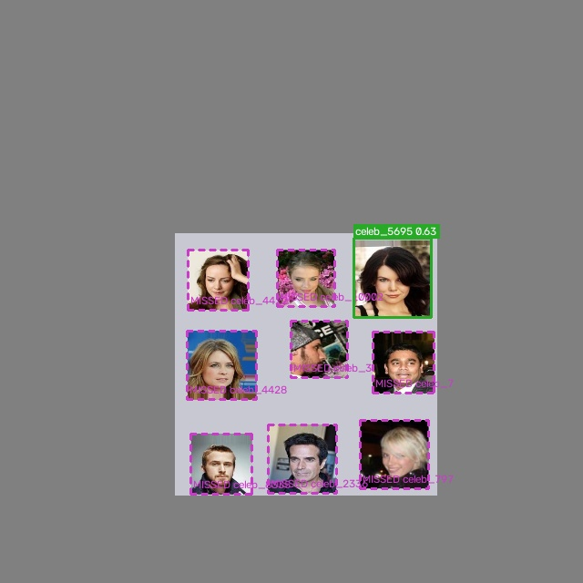

**Failure.** Stress test (from Milestone 3): 1/9 faces detected with the correct identity; confidence 0.63-0.63; missed celeb_2336, celeb_10002, celeb_797, celeb_3, celeb_4422, celeb_4428, celeb_8335, celeb_7.

### 17_test_0002_blur.jpg

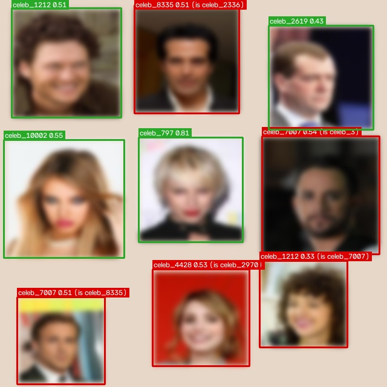

**Failure.** Stress test (from Milestone 3): 4/9 faces detected with the correct identity; confidence 0.43-0.81; identity confusion: celeb_3 predicted as celeb_7007; celeb_2970 predicted as celeb_4428; celeb_8335 predicted as celeb_7007; celeb_2336 predicted as celeb_8335; celeb_7007 predicted as celeb_1212.

### 18_test_0002_dark.jpg

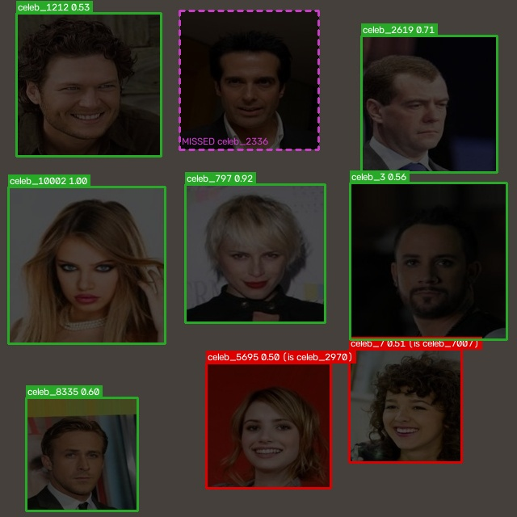

**Partial.** Stress test (from Milestone 3): 6/9 faces detected with the correct identity; confidence 0.53-1.00; missed celeb_2336; identity confusion: celeb_7007 predicted as celeb_7; celeb_2970 predicted as celeb_5695.

### 19_test_0002_small.jpg

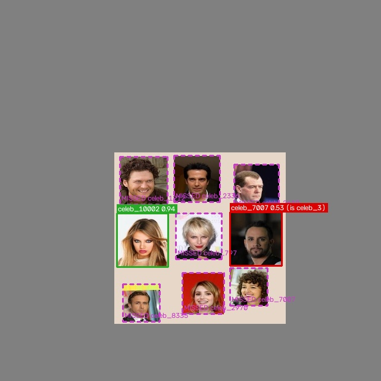

**Failure.** Stress test (from Milestone 3): 1/9 faces detected with the correct identity; confidence 0.94-0.94; missed celeb_2619, celeb_1212, celeb_7007, celeb_2970, celeb_797, celeb_2336, celeb_8335; identity confusion: celeb_3 predicted as celeb_7007.
